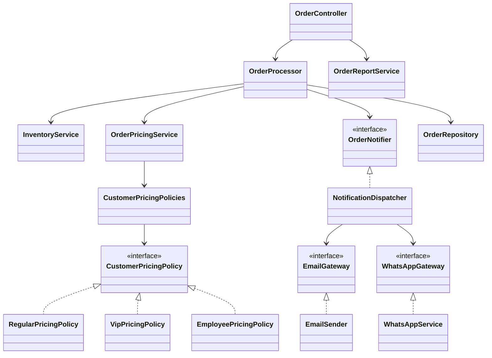

# Decisiones técnicas

## Arquitectura resultante

`OrderProcessor` pasó de concentrar seis responsabilidades (223 líneas) a coordinar el caso de uso (81 líneas). Cada componente tiene un único motivo de cambio.

```
controller/   OrderController, ProductController, OrderRequestDto, ApiExceptionHandler
service/      OrderProcessor (coordina), InventoryService, OrderReportService,
              OrderRequest, OrderLineRequest, SalesReport
pricing/      OrderPricingService, CustomerPricingPolicy (interfaz) + Regular/Vip/Employee,
              CustomerPricingPolicies, Amounts
notification/ OrderNotifier (interfaz), NotificationDispatcher,
              EmailGateway / WhatsAppGateway (interfaces), EmailSender, WhatsAppService
model/        Order, OrderItem, Product, OrderStatus, CustomerInfo, DeliveryAddress, PriceBreakdown
exception/    BusinessRuleException, InsufficientStockException, OrderNotFoundException
```



## Principios aplicados

| Principio | Cómo se aplicó |
|---|---|
| SRP | `OrderPricingService` (precios), `InventoryService` (stock), `NotificationDispatcher` (avisos), `OrderReportService` (reporte); `OrderProcessor` solo coordina. |
| OCP | Una `CustomerPricingPolicy` por tipo de cliente. Un tipo nuevo es una clase `@Component` nueva, sin modificar las existentes. |
| LSP | La base no tenía jerarquías. En el diseño nuevo, toda política respeta el contrato de la interfaz (descuento entre 0 y el subtotal), verificado por `CustomerPricingPolicyContractTest`. |
| ISP | Un gateway por canal (`EmailGateway`, `WhatsAppGateway`); `OrderProcessor` ve solo `OrderNotifier`, con los tres eventos de negocio. |
| DIP | Aplicado a la infraestructura: `OrderProcessor` depende de `OrderNotifier` y `OrderRepository`, inyectados por constructor. Los servicios de dominio siguen siendo concretos (YAGNI) y se simulan con Mockito. |

## Registro de decisiones

### ADR-001 · Strategy para las reglas de precio por tipo de cliente

- **Contexto:** `processOrder()` preguntaba dos veces por `"VIP"` y una por `"EMPLEADO"` (S6). Sumar un tipo obligaba a editar el método central.
- **Decisión:** interfaz `CustomerPricingPolicy` con una implementación por tipo; `CustomerPricingPolicies` las recibe por inyección y devuelve `RegularPricingPolicy` ante un tipo desconocido (*Null Object*), igual que la base (C07).
- **Consecuencias:** más clases (el total de líneas sube de 567 a 966), a cambio de que cada regla viva en un solo lugar.

### ADR-002 · Reserva de stock transaccional (cambio deliberado D1)

- **Contexto:** el stock se descontaba y guardaba ítem por ítem, sin transacción. Un pedido rechazado dejaba descontados los ítems previos (S1).
- **Decisión:** `createOrder()` es `@Transactional` y `InventoryService` exige una transacción activa (`Propagation.MANDATORY`, CR-01).
- **Consecuencias:** cambia el comportamiento externo: tras un pedido rechazado el stock queda intacto. La prueba C14 pasa de esperar 19 a 20 en el mismo commit (R2).

### ADR-003 · Errores de dominio y `404` para pedidos inexistentes (cambio deliberado D2)

- **Contexto:** `RuntimeException` genérica en 14 lugares y `catch (Exception)` en cada endpoint; un pedido inexistente respondía `200` vacío al consultar y `400` al cancelar o entregar (S4).
- **Decisión:** jerarquía `BusinessRuleException` (400) ← `InsufficientStockException`, y `OrderNotFoundException` (404), traducidas en un único `ApiExceptionHandler`.
- **Consecuencias:** `404 Pedido no encontrado: N` en consultar, cancelar y entregar; los errores inesperados dan `500`. C20 y C22 se actualizan en el mismo commit.

### ADR-004 · Montos en `double`, sin cambios

- **Contexto:** `double` no es adecuado para dinero (CR-05).
- **Decisión:** no migrar a `BigDecimal` en este refactor. El cálculo respeta el orden de las operaciones de la base y suma con `reduce(0, Double::sum)` para reproducir la suma secuencial por construcción.
- **Consecuencias:** los montos y el texto de los avisos son idénticos a la base. La migración a un *value object* `Money` queda para una versión nueva de la API.

### ADR-005 · Consultas con `findAll()`, sin cambios

- **Contexto:** `listOrders()` y el reporte cargan todos los pedidos y filtran en memoria.
- **Decisión:** mantenerlo. El refactor no cambia propiedades de rendimiento.
- **Consecuencias:** queda como mejora futura reemplazarlo por consultas como `findByStatus`.

## Pendientes aceptados en la revisión

| ID | Pendiente |
|---|---|
| CR-03 | Notificar después del commit con eventos y `@TransactionalEventListener(AFTER_COMMIT)`. |
| CR-04 | DTO de respuesta para no exponer la entidad JPA `Order`. |
| CR-05 | *Value object* `Money` con `BigDecimal` en una versión nueva de la API. |
| CR-07 | Rechazar tipos de cliente desconocidos, a acordar con el negocio. |
